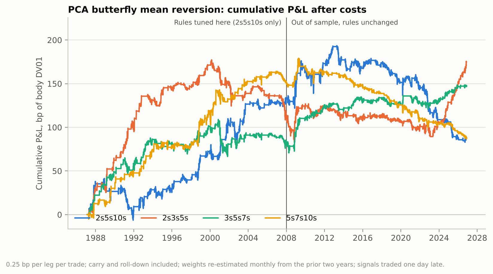
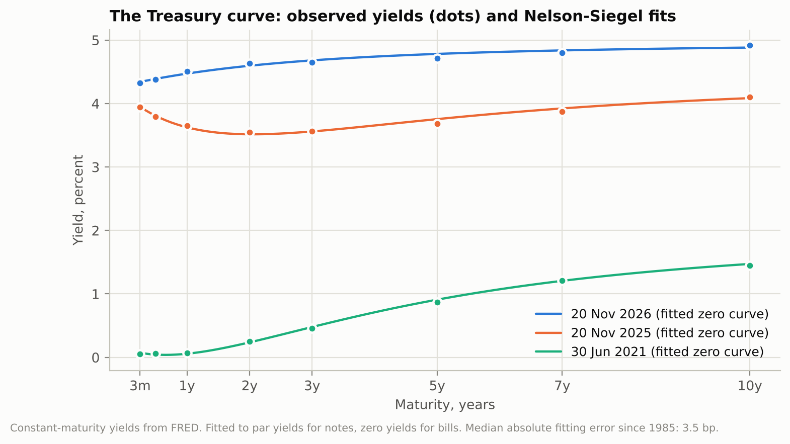
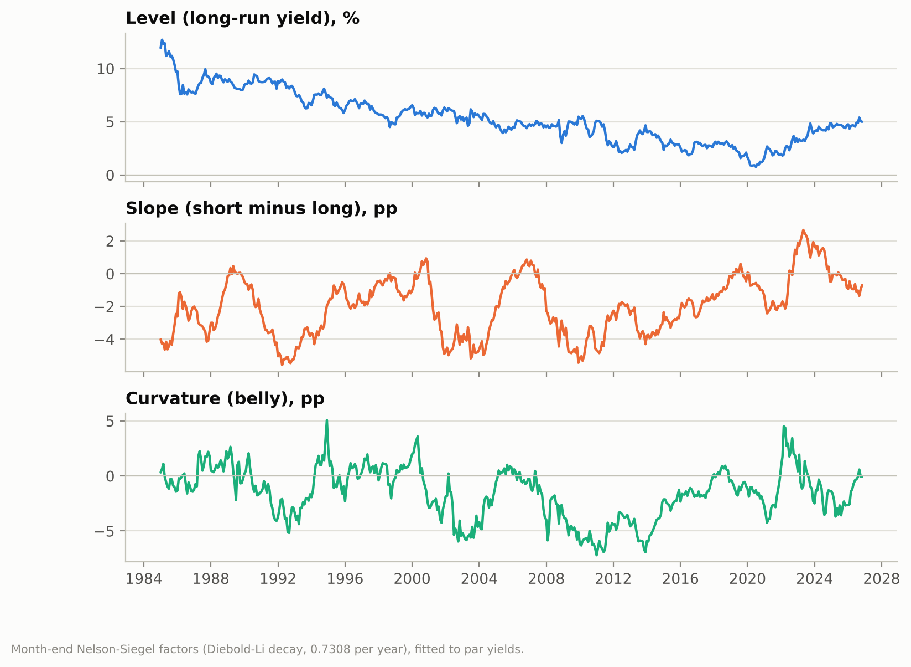
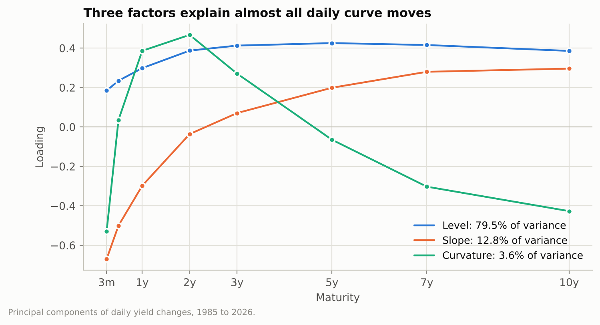
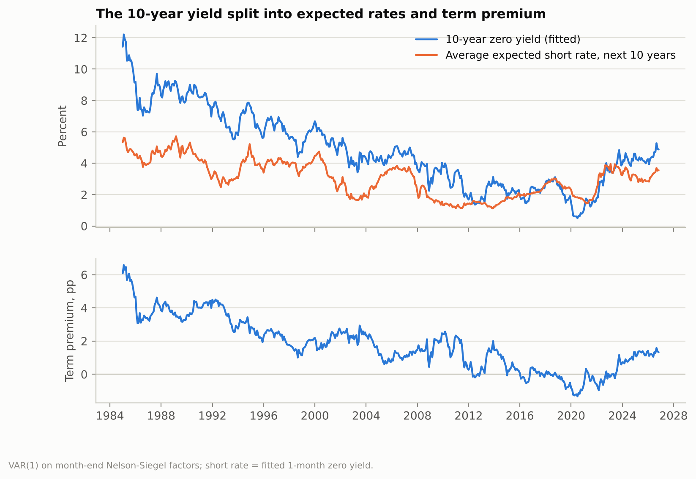
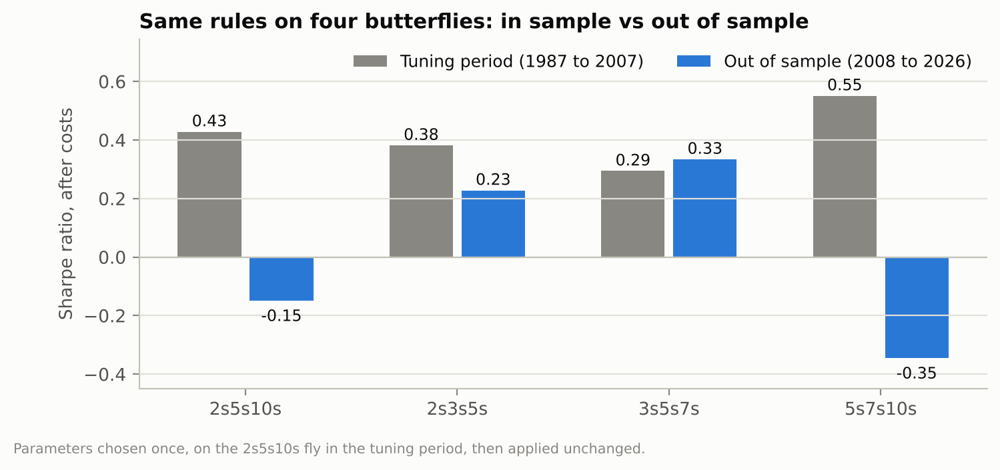

# Yield Curve and Relative Value Lab

**Jay Leggette** · Stanford University · data through 20 November 2026

A toolkit for the U.S. Treasury curve, built from public daily data (1985 to 2026), and an honest test of a classic relative-value trade:

1. **Curve fitting:** a Nelson-Siegel curve fitted to *par* yields, the way the Treasury quotes them.
2. **Factors:** principal components of daily curve moves (level, slope, curvature).
3. **Term premium:** the 10-year yield split into the expected path of short rates and a term premium.
4. **Relative value:** PCA-weighted, DV01-neutral butterflies traded on mean reversion. The backtest charges costs and credits carry and roll-down. Rules are tuned on 1987 to 2007, then run unchanged on 2008 to 2026.

The main finding is a negative one, and the repo is built to show it cleanly. The trade worked before 2008 on every butterfly tested. Afterwards it kept working on the short butterflies and broke on the ones that include the 10-year. The reason is not leaking hedges. Mean reversion at the long end slowed down.

---

## Headline results

| | |
|---|---|
| **Curve fit** | Nelson-Siegel with the Diebold-Li decay fits the eight CMT points with a median absolute error of **3.5 bp** since 1985. |
| **Rich and cheap today** | Against the fitted curve on 20 Nov 2026, the **5-year is 6.0 bp rich** and the **10-year 5.7 bp cheap**. |
| **Factors** | Level, slope and curvature explain **79.5%, 12.8% and 3.6%** of daily yield changes (96% together). |
| **Term premium** | The 10-year zero yield of 4.88% splits into **3.55%** of expected short rates and a **1.33 pp** term premium. A year before the pandemic (2019) the premium averaged **-0.48 pp**. |
| **Tuning period, 1987 to 2007** | The PCA butterfly earns a Sharpe ratio of **0.29 to 0.55** after costs on all four butterflies tested. |
| **Out of sample, 2008 to 2026** | With the rules unchanged, **3s5s7s: +0.33** and **2s3s5s: +0.23**, but **2s5s10s: -0.15** and **5s7s10s: -0.35**. All 18 parameter settings for 2s5s10s lose money out of sample. |
| **Why** | The hedges held: level and slope explain at most 4.6% of any butterfly's daily moves in any period. Instead, the half-life of the 2s5s10s and 5s7s10s curvature residuals doubled after 2008 (114 to 168 days and 83 to 163 days). The 3s5s7s half-life did not change (68 to 70 days). |
| **Costs matter** | At 0.5 bp per leg per trade instead of 0.25 bp, every butterfly is negative out of sample. The edge is real but thin. |



---

## 1. Data

FRED daily constant-maturity Treasury yields: 3 and 6 months; 1, 2, 3, 5, 7 and 10 years (`DGS3MO` to `DGS10`). That gives 10,476 days from 2 January 1985 to 20 November 2026 with all eight points. Bills and the 1-year point are treated as zero-coupon yields, and notes from 2 years as par yields on semiannual coupons.

An optional file `data/raw/fred_daily_long.csv` with `THREEFYTP10` (the Fed Board's Kim-Wright term premium) switches on a benchmark comparison automatically.

## 2. Curve fitting



Nelson-Siegel describes the zero curve with three factors:

```
z(τ) = β₁ + β₂·(1 − e^{−λτ})/(λτ) + β₃·[(1 − e^{−λτ})/(λτ) − e^{−λτ}]
```

The decay λ is fixed at 0.7308 per year (Diebold and Li, 2006).

The detail that matters: CMT note yields are par yields. Treating them as zero yields is a common shortcut that misprices a steep curve at 10 years by several basis points. Here each note is priced off the fitted zero curve with semiannual coupons, and the factors are solved so that model par yields match observed ones.



## 3. Principal components



These are the textbook shapes (Litterman and Scheinkman, 1991): a near-parallel level shift, a slope factor, and a curvature factor. Including the 3-month bill adds a bill-specific wiggle to the third component. The three components explain 96% of daily variance. Curvature's share was 2.8% before 2008 and 4.9% after. That rise is the first hint that curvature behaved differently after 2008.

## 4. Term premium



A VAR(1) on month-end Nelson-Siegel factors projects the 1-month zero rate forward. The risk-neutral 10-year yield is its average over the next 120 months, and the term premium is the gap to the fitted 10-year zero yield. This is the statistical half of Adrian, Crump and Moench (2013), without their pricing restrictions.

The premium falls from about 6 pp in 1985 to below zero around 2019 and 2020, then climbs back to **1.33 pp** in November 2026. Treat the level with caution. Highly persistent factors make any VAR-based split sensitive to the estimated speed of mean reversion; here the largest eigenvalue is 0.983. That is why the code compares against Kim-Wright when the file is present.

## 5. Relative value: PCA butterflies

**The trade.** Each butterfly (for example 2s5s10s) is long the 5-year body and short the 2-year and 10-year wings, or the reverse. Weights are in DV01 terms and are chosen so the position has *zero* exposure to the first two principal components, level and slope. What is left is the curvature residual

```
F_t = w_a·y_a + y_b + w_c·y_c        (bp; latest 2s5s10s weights −0.46 / 1.00 / −0.65)
```

**Signal.** When F is unusually high (z-score above the entry level), the body is cheap, so the trade goes long the body. Exit when z crosses back through the exit level or after 63 trading days.

**No look-ahead.** PCA weights are re-estimated each month from the previous two years of daily changes. z-scores use each day's own weights over a trailing window. A signal seen at a close is traded at the *next* close.

**P&L.** P&L is in basis points of the body's DV01, so $10,000 of body DV01 makes 1 bp worth $10,000. It includes:
* yield changes on each leg;
* carry, with the leg yield over the 3-month bill as a funding proxy;
* roll-down from the local slope under each leg;
* 0.25 bp per leg on every entry, exit and monthly re-weighting.

**Tuning.** There are 18 settings: entry z of 1.0, 1.5 or 2.0; exit z of 0 or 0.5; z-score window of 126, 252 or 504 days. They were compared on 2s5s10s in 1987 to 2007 only. The winner (entry 2.0, exit 0, 126-day window, in-sample Sharpe 0.43) was then applied unchanged to every butterfly and to 2008 to 2026.

### Results

| Butterfly | Tuning Sharpe | Out-of-sample Sharpe | Out-of-sample bp/yr | Trades | Hit rate | Max drawdown | Half-life before → after 2008 |
|---|---|---|---|---|---|---|---|
| **3s5s7s** | 0.29 | **+0.33** | +3.5 | 82 | 74% | −15 bp | 68 → 70 days |
| **2s3s5s** | 0.38 | **+0.23** | +3.2 | 96 | 69% | −37 bp | 22 → 46 days |
| 2s5s10s | 0.43 | −0.15 | −2.5 | 59 | 56% | −111 bp | 114 → 168 days |
| 5s7s10s | 0.55 | −0.35 | −3.4 | 70 | 43% | −92 bp | 83 → 163 days |



**Costs** (out-of-sample Sharpe):

| Cost per leg per trade | 0 bp | 0.25 bp | 0.5 bp | 1 bp |
|---|---|---|---|---|
| 3s5s7s | 0.78 | 0.33 | −0.10 | −0.84 |
| 2s3s5s | 0.61 | 0.23 | −0.14 | −0.82 |
| 2s5s10s | 0.06 | −0.15 | −0.35 | −0.74 |
| 5s7s10s | 0.05 | −0.35 | −0.72 | −1.33 |

### What changed after 2008

I first suspected the hedges: weights estimated over the zero-rate years, when the 2-year barely moved, might have leaked slope risk once the Fed started hiking in 2022. **The data reject that.** I regressed each butterfly's daily move on the curve's own level and slope moves. Level and slope explain at most 2.3% of the variance for 2s5s10s in any period: 1987 to 2007, 2008 to 2021, or 2022 to 2026.

What did change is the *speed of mean reversion*. Half-lives of the two butterflies that include the 10-year roughly doubled, while 3s5s7s stayed put. The losses also landed off the zero bound: 2s5s10s lost 10.7 bp a year away from zero rates out of sample and made 4.5 bp a year at the zero bound. A plausible reading is that the 10-year sector picked up persistent, non-mean-reverting moves from QE purchases, term-premium swings and Treasury supply. Those are exactly the forces that PCA level and slope do not capture.

**Concentration check.** 3s5s7s made money in 13 of 19 out-of-sample years. 2s3s5s is less convincing: 46 of its 61 bp came in 2025 and 2026.

---

## Limitations

* **Constant-maturity yields are not tradable bonds.** P&L adds roll-down explicitly, but real positions hold specific issues with their own richness, repo specialness and on/off-the-run spreads.
* **Funding is approximated** by the 3-month bill. Repo can trade well away from bills in stress.
* **Costs are a single number.** 0.25 bp per leg is reasonable for on-the-run notes in normal markets and too low in stress. The cost table shows how much it matters.
* **The term premium is model-dependent.** VAR-based splits move with the estimated persistence. A benchmark comparison is wired in for when the Kim-Wright file is supplied.
* **The diagnosis is after the fact.** The half-life and regime analysis comes after seeing the out-of-sample result, so it is an explanation to test going forward, not a validated new rule.

## Reproduce

```bash
pip install -r requirements.txt
python scripts/run_all.py      # about 15 seconds
python -m pytest -q            # 11 tests
```

The tests include checks that the butterfly weights are exactly neutral to level and slope, that weights use only past data (scrambling later data leaves earlier weights unchanged), and that a signal is never traded on the day it fires.

```
src/rvlab/
  data.py         loading the CMT curve
  curve.py        Nelson-Siegel zero curve, par pricing, daily fits
  pca.py          principal components with stable sign conventions
  termpremium.py  VAR(1) expected short rates and term premium
  rv.py           PCA butterfly weights, signals, backtest, carry and roll, statistics
  plots.py        figures
scripts/run_all.py
tests/
outputs/tables/   every number in this README, as CSV
```

## References

* Adrian, T., R. Crump and E. Moench (2013). Pricing the term structure with linear regressions. *Journal of Financial Economics*.
* Diebold, F. and C. Li (2006). Forecasting the term structure of government bond yields. *Journal of Econometrics*.
* Kim, D. and J. Wright (2005). An arbitrage-free three-factor term structure model and the recent behavior of long-term yields and distant-horizon forward rates. Federal Reserve Board FEDS 2005-33.
* Litterman, R. and J. Scheinkman (1991). Common factors affecting bond returns. *Journal of Fixed Income*.
* Nelson, C. and A. Siegel (1987). Parsimonious modeling of yield curves. *Journal of Business*.

MIT License.
